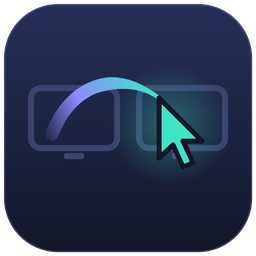
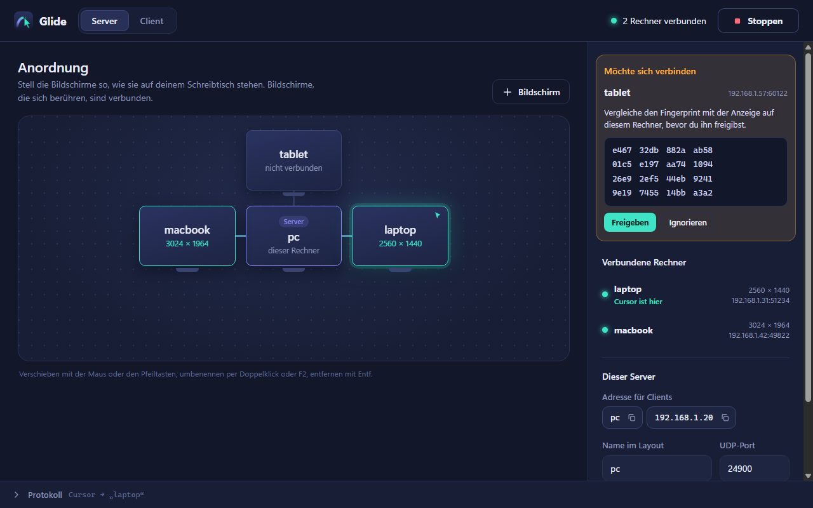
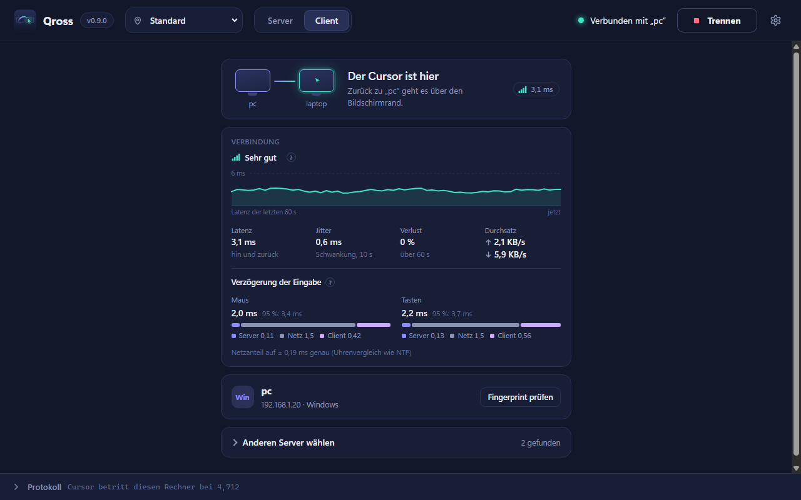
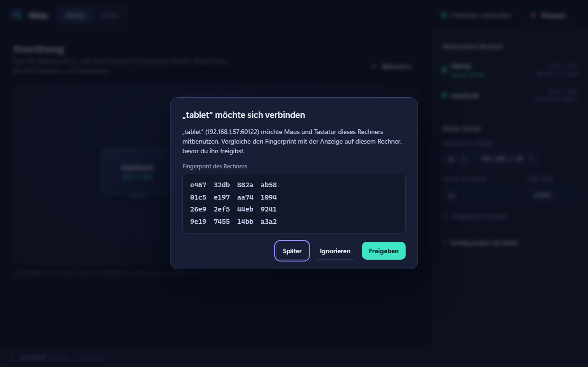
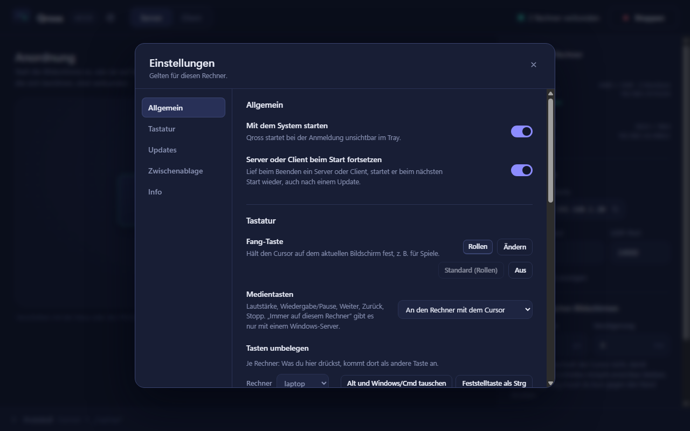
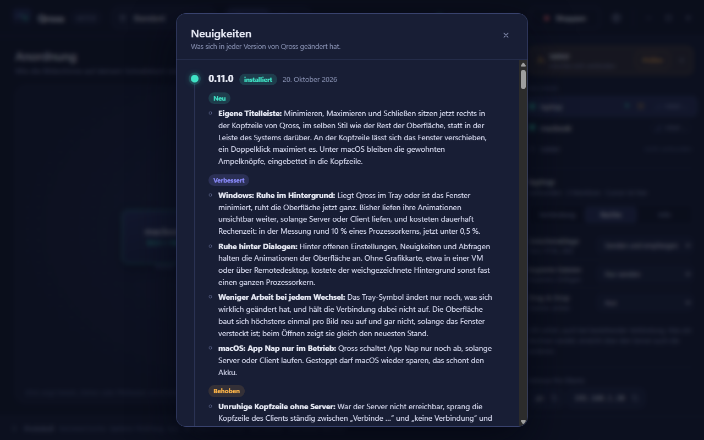
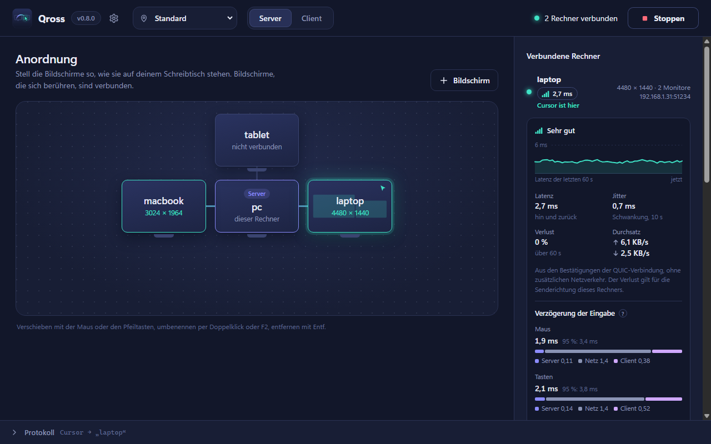

<p align="center">
  
</p>

<h1 align="center">Qross</h1>

<p align="center">Maus, Tastatur, Clipboard und Dateien über mehrere Rechner teilen – schnell, sicher, über QUIC.</p>

<p align="center">
  <a href="https://github.com/xozy22/qross/actions/workflows/ci.yml"></a>
  <a href="https://github.com/xozy22/qross/releases/latest"></a>
  <a href="LICENSE"></a>
</p>

Eine eigene Implementierung in der Art von Synergy, geschrieben in Rust. Statt TCP verwendet Qross ein eigenes
Protokoll über **QUIC**. Bei Paketverlust (WLAN) bleibt der Cursor damit flüssig, wo ein TCP-Transport wie der von
Synergy 200–600 ms hängt ([Benchmark](docs/benchmark-ergebnisse.md)). Große Dateien wandern per **Drag & Drop** über
die Bildschirmkante, ohne dass Maus und Tastatur ins Stocken geraten. Kopierte Dateien lassen sich auf dem
anderen Rechner einfach **einfügen** (Strg+C hier, Strg+V dort).

<p align="center">
  
</p>

<table>
  <tr>
    <td align="center"><br><sub>Client: Server im Netzwerk finden und mit einem Klick verbinden</sub></td>
    <td align="center"><br><sub>Neuer Rechner: Freigabe erst nach Fingerprint-Vergleich</sub></td>
  </tr>
  <tr>
    <td align="center"><br><sub>Einstellungen: Autostart, Updates, Fang-Taste, Medientasten, Tasten je Rechner</sub></td>
    <td align="center"><br><sub>Neuigkeiten: Klick auf die Version in der Kopfzeile zeigt, was sich geändert hat</sub></td>
  </tr>
  <tr>
    <td align="center" colspan="2"><br><sub>Verbindungsqualität je Rechner: Latenz, Jitter, Verlust, Durchsatz und Verlauf der letzten Minute</sub></td>
  </tr>
</table>

<sub>Die Screenshots zeigen Demo-Daten.</sub>

## Warum Qross statt Synergy?

| | Synergy 3 | Qross |
|---|---|---|
| Transport | TCP + TLS, ein Kanal für alles | QUIC: Maus als Datagramm, Tasten, Clipboard und Dateien auf getrennten Streams |
| Cursor bei 1 % / 5 % Paketverlust (p99)¹ | 36 ms / 588 ms | 4 ms / 4,5 ms |
| Eingaben während eines 2-MB-Clipboards (p99)¹ | 116 ms (0 % Verlust) / 248 ms (1 %) | 32 ms / 5 ms, keine Ruckler über 50 ms |
| Screenshots & formatierter Text in der Zwischenablage | ja | ja, als PNG bzw. HTML, ohne die Eingaben auszubremsen |
| Dateien per Drag & Drop | über dieselbe Verbindung wie die Eingaben | eigener Stream je Datei, SHA-256-geprüft, auch GB-große Dateien und Ordner |
| Dateien kopieren und einfügen | nicht über die Zwischenablage, nur per Drag & Drop | Strg+C im Explorer, Strg+V auf dem anderen Rechner, in beide Richtungen, bis 1 GB automatisch |
| Vertrauen | TLS mit Fingerprint-Bestätigung | gegenseitige Zertifikate: der Server gibt Clients explizit frei, der Client merkt sich den Server |
| Versehentliches Wechseln an Ecken | Ecken-Schutz muss konfiguriert werden | Ecken-Totzone ab Werk, optionale Wechselverzögerung |
| PC ↔ Mac | Modifier von Hand umbelegen | Strg/Cmd wird automatisch getauscht |
| Verbindungsabbruch mitten in einer Eingabe | Tasten können hängen bleiben | Client lässt alles los; Notausgang Strg+Alt+Shift+Esc |

¹ Gemessen mit [`netbench`](bench/netbench/README.md): Linux-netem, 100 Mbit/s, 1 ms Verzögerung. Die Spalte
„Synergy 3“ ist eine Nachbildung von Synergys Transport (TCP+TLS, ein gemeinsamer Kanal), nicht das Original-
programm. Details im [Benchmark](docs/benchmark-ergebnisse.md).

## Funktionen und Stand

| | Windows | Linux (X11) | Linux (Wayland)³ | macOS |
|---|---|---|---|---|
| Server: Eingaben erfassen, Kanten pro Monitor | ✔ | ✔ | ✔ GNOME ≥ 45, KDE ≥ 6.1, Hyprland ≥ 0.56 | ✔¹ |
| Client: Eingaben einspeisen | ✔ | ✔ | ✔ GNOME ≥ 45, KDE ≥ 6.1, sonst über XWayland | ✔¹ |
| Zwischenablage in beide Richtungen: Text, HTML, Bilder (z. B. Screenshots) | ✔ | ✔ | ✔ KDE, wlroots direkt; GNOME über XWayland | ✔¹ |
| Dateien kopieren und einfügen, in beide Richtungen | ✔ Explorer | ✔ Dateimanager mit `text/uri-list` (Nautilus, Dolphin) | wie Zwischenablage | ✔ Finder¹ |
| Passwörter nicht teilen: was Passwortmanager als vertraulich markieren, bleibt auf dem Rechner | ✔ Formate für Verlauf, Cloud und Zwischenablage-Programme | ✔ `x-kde-passwordManagerHint` (KeePassXC) | wie Zwischenablage | ✔ `ConcealedType`, `TransientType`¹ |
| Cursor auf dem Server ausblenden | ✔ | ✔ | Sache des Compositors | soweit macOS es zulässt¹ |
| Drag & Drop **vom Server** ziehen | ✔ | – | – | – |
| Drag & Drop **vom Client** zum Server ziehen | ✔ Explorer | – | – | ✔ Finder¹ |
| Gezogene Dateien **ablegen** | ✔ Explorer/Desktop unter dem Cursor | ✔ in `~/Downloads/Qross` | Client: in `~/Downloads/Qross` | ✔ in `~/Downloads/Qross`¹ |
| Fang-Taste frei wählbar, Medientasten, Tasten je Rechner umbelegen | ✔ | ✔² | Fang-Taste nur, solange der Cursor auf einem Client ist | ✔¹ ² |
| Zeichen statt Tastenposition je Rechner: anderes Tastaturlayout, tote Tasten, AltGr | ✔ | ✔ | – (bleibt Tastenposition) | ✔¹ |
| Mehrere Monitore je Rechner: Skizze im Layout, Cursor nur auf Monitorflächen | ✔ | ✔ | ✔ in logischen Pixeln | ✔¹ |
| Verbindungsqualität: Latenz, Jitter, Verlust, Durchsatz | ✔ | ✔ | ✔ | ✔¹ |
| Spielemodus: bei Vollbild festhalten, relative Mausbewegung für Spiele | ✔ Vollbild, eingefangener Zeiger | ✔ Vollbild | – | ✔ Vollbild¹ |
| Dateiübertragungen: Fortschritt, Rate und Restzeit, Abbrechen auf beiden Seiten | ✔ | ✔ | ✔ | ✔¹ |
| Rechte je Rechner: Zwischenablage, kopierte Dateien, Drag & Drop je Richtung erlauben oder sperren | ✔ | ✔ | ✔ | ✔¹ |
| Grafische Oberfläche mit Layout-Editor | ✔ | ✔² | ✔², mit Hinweisen zu Portal und Freigabe | ✔² |
| Profile je Ort, automatisch nach Netzwerk (Gateway, ohne Zusatzrechte)⁴ | ✔ mit Netzwerkname | ✔, Name über NetworkManager | ✔ wie X11 | ✔ ohne WLAN-Namen¹ |

¹ macOS wird in der CI auf Apple Silicon gebaut und getestet, auch mit der echten Zwischenablage. Erfassung und
Einspeisung sind auf einem echten Mac noch nicht geprüft. Qross braucht dort die Rechte „Bedienungshilfen“ und
„Eingabeüberwachung“.
² „Medientasten immer auf dem Server“ wirkt mit einem Windows-Server. Unter macOS bleiben Medientasten des
Servers ohnehin dort, unter X11 gehen sie immer an den aktiven Rechner.
² Die Oberfläche basiert auf Tauri; gebaut und geprüft wurde sie unter Windows.
³ Wayland läuft über die Desktop-Portale RemoteDesktop und InputCapture und libei. Das System fragt
einmal nach der Freigabe; wo der Desktop es kann, merkt sich Qross sie (GNOME fragt beim Erfassen bis
Version 50 bei jedem Start). Geprüft sind die Logik, das Einspeisen über libei gegen eine eigene
Gegenstelle und gegen mutter ohne Bildschirm. Auf einem echten GNOME- oder KDE-Desktop ist Wayland
noch nicht getestet, ebenso wenig der Freigabe-Dialog. Sway und andere wlroots-Desktops: Server nur in
einer X11-Sitzung. Details, Grenzen und Testanleitung: [Wayland](docs/wayland.md).
⁴ Nur in der Oberfläche; `qross.toml` bleibt eine Konfiguration (für mehrere Orte mehrere Dateien und
`--config`). Erkannt wird das Netzwerk an Adresse und MAC-Adresse des Standard-Gateways und am Subnetz. Den
WLAN-Namen gibt macOS ab Version 14 nur mit Ortungsdiensten heraus; Qross fragt nicht danach. Unter Windows
echt geprüft; Linux und macOS lesen Routen und ARP-Cache aus `/proc/net` bzw. `netstat`, dort nur mit Testdaten
geprüft.

**Wie geprüft wurde:**
- Plattformunabhängige Logik, Protokoll und Netzwerk: Unit-Tests und Ende-zu-Ende-Tests über echtes QUIC
  (Wechsel, Eingaben, Zwischenablage mit Text, HTML und Bildern, Drag & Drop mit 8 MB und Ordnern, kopierte
  Dateien und Ordner in beide Richtungen, Drag & Drop zum Server, Fortschritt und Abbrechen von Sender und
  Empfänger, mehrere Monitore je Client, Messwerte der Verbindungsqualität, Spielemodus samt Gegenstellen aus 0.5,
  Wechsel per Tastenkürzel, Zeichen statt Tastenposition samt Gegenstellen aus 0.6, Rechte je Rechner für jede
  Art und Richtung samt sofortiger Änderung und einem älteren Client, der es trotzdem versucht, zurückgehaltene
  vertrauliche Inhalte, Ablehnung unbekannter Clients, LAN-Suche).
- Windows-Tastaturlayouts: echter Test mit dem deutschen und dem US-Layout (AltGr, tote Tasten, Kürzel), soweit
  sie auf dem Rechner eingerichtet sind.
- Windows-Zwischenablage: echter Test mit Text, HTML, PNG und Screenshot-Bitmap (DIB) sowie kopierten Dateien,
  die der Explorer anschließend selbst einfügt, und mit den Formaten, mit denen Passwortmanager markieren.
- Linux: echte Tests gegen einen X-Server (Xvfb in Docker).
- Wayland: Einspeisen über libei gegen eine EIS-Gegenstelle im Test und gegen mutter ohne Bildschirm
  (eigener CI-Job, noch experimentell). Portal, Freigabe-Dialog und Erfassen sind nur übersetzt, nicht
  auf einem echten Desktop geprüft.
- Windows: Bau- und Smoke-Tests sowie die Explorer-Ordnererkennung. Hooks und Einspeisung wurden noch nicht
  mit zwei echten Rechnern getestet.

**Bedienung:**
- **Rollen-Taste** hält den Cursor auf dem aktuellen Bildschirm fest, z. B. für Spiele. Die Taste ist frei
  wählbar (Einstellungen bzw. `[keys] lock` in `qross.toml`).
- **Spielemodus:** Läuft auf dem Rechner mit dem Cursor ein Spiel, ein Video oder eine Präsentation im Vollbild,
  bleibt der Cursor dort, bis es endet. Spiele auf einem Client bekommen dabei relative Mausbewegungen wie von
  einer echten Maus, auch wenn sie den Zeiger einfangen. Die Fang-Taste gibt den Cursor frei; abschaltbar in
  den Einstellungen bzw. mit `[game] enabled = false`.
- **Strg+Alt+Shift+Esc** holt Maus und Tastatur sofort zurück (macOS: Strg+Option+Shift+Esc).
- **Profile je Ort** (Einstellungen → Profile): z. B. „Büro“ als Client und „Zuhause“ als Server mit eigener
  Anordnung. Ein Profil umfasst alles aus dem Hauptfenster: Rolle, Anordnung, Name und Port, Wechsel und die
  Server-Adresse. Umschalten in der Kopfzeile oder im Tray-Menü. Mit „Aktuelles Netzwerk übernehmen“ wählt
  Qross das Profil beim Start und bei jedem Netzwerkwechsel selbst und startet Server bzw. Client neu.
- **Kürzel zum Wechseln** (frei belegbar, Einstellungen → Tastatur bzw. `[keys.switch]`): zu einem bestimmten
  Rechner, der Cursor landet in dessen Mitte, oder zum Nachbarn links, rechts, oben oder unten, dann an der
  gegenüberliegenden Kante. Sie wirken auf jedem Rechner und erreichen keine Programme; hält die Fang-Taste den
  Cursor fest, wechselt er nicht. Unter X11 wirkt ein Kürzel, das der Desktop schon belegt (etwa Strg+Alt+Pfeil
  für Arbeitsflächen), nur, solange der Cursor auf einem anderen Rechner ist.
- **Rechte je Rechner** (Server-Ansicht bzw. `[sharing]`): je Client und Art – Zwischenablage, kopierte Dateien,
  Drag & Drop – senden und empfangen, nur empfangen, nur senden oder aus. Was ein Client sendet, erreicht über
  den Server auch andere Rechner, soweit sie es empfangen dürfen. Der Server setzt das selbst durch, auch bei
  älteren Clients; Änderungen gelten sofort.
- **Zeichen statt Tastenposition** (je Rechner, Einstellungen → Tastatur bzw. `[keys.mode]`): Standard ist die
  Tastenposition, dort bestimmt das eigene Layout das Zeichen. Auf „Zeichen“ kommt an, was du auf dem Server
  tippst, auch bei anderem Layout (z. B. Server Deutsch, Mac US): Y und Z, Umlaute, @, €, Klammern, ^ und ´.
  Kürzel wie Strg+Z gehen nach dem Zeichen, Pfeile, F-Tasten und Co. bleiben Tasten. Für Spiele die
  Tastenposition lassen. Clients mit älterem Qross oder unter Wayland bekommen weiter Tastenpositionen.

## Download

Fertige Pakete gibt es unter [Releases](https://github.com/xozy22/qross/releases/latest):

| System | App | Kommandozeile |
|---|---|---|
| Windows x64 | `.msi` oder `-setup.exe` | `qross-…-x86_64-pc-windows-msvc.zip` |
| macOS Apple Silicon | `.dmg` | `qross-…-aarch64-apple-darwin.tar.gz` |
| Linux x64 | `.AppImage` oder `.deb` | `qross-…-x86_64-unknown-linux-gnu.tar.gz` |

Die Programme sind nicht von Microsoft bzw. Apple beglaubigt, deshalb fragt das System beim ersten Start nach:

- **Windows:** SmartScreen meldet sich, dann „Weitere Informationen → Trotzdem ausführen“.
- **macOS:** Qross aus dem DMG in „Programme“ ziehen und öffnen. macOS meldet, dass es die App nicht
  überprüfen kann. Dann unter **Systemeinstellungen → Datenschutz & Sicherheit** ganz unten „Dennoch öffnen“
  wählen. Danach dort „Bedienungshilfen“ und „Eingabeüberwachung“ für Qross erlauben. Alternativ im Terminal:

  ```bash
  xattr -dr com.apple.quarantine /Applications/Qross.app
  ```

  Für die Kommandozeile entsprechend `xattr -d com.apple.quarantine qross` im entpackten Ordner.

### macOS: Rechte über Updates behalten

macOS merkt sich „Bedienungshilfen“ und „Eingabeüberwachung“ zusammen mit der Signatur der App, genauer mit
ihrer designierten Anforderung. Bis 0.5.0 war Qross nur ad hoc signiert, dort steckt in dieser Anforderung eine
Prüfsumme genau dieses Builds. Jedes Update galt deshalb als andere App: Qross blieb in der Liste eingeschaltet,
die Rechte wirkten aber nicht mehr, und Maus und Tastatur kamen nicht an.

Ab der ersten Version nach 0.5.0 ist Qross mit einem eigenen, dauerhaften Zertifikat („Qross Code Signing“)
signiert. Die Anforderung nennt dann nur noch den Bundle-Identifier und das Zertifikat, und die Rechte bleiben
über Updates erhalten. Beim Update von 0.5.0 oder älter müssen sie ein letztes Mal neu erteilt werden:

1. Qross starten. Fehlt ein Recht, zeigt Qross oben im Fenster einen Hinweis.
2. Unter **Systemeinstellungen → Datenschutz & Sicherheit → Bedienungshilfen** Qross auswählen und mit „−“
   entfernen. Der alte Eintrag bleibt sonst eingeschaltet, wirkt aber nicht.
3. Im Hinweis von Qross „Freigeben …“ wählen und Qross in der Liste einschalten.
4. Läuft dieser Mac als Server, dasselbe unter **Eingabeüberwachung**. macOS bietet danach an, Qross neu zu öffnen.

Statt Schritt 2 geht auch das Terminal, danach Qross neu starten:

```bash
tccutil reset Accessibility app.qross.desktop
```

```bash
tccutil reset ListenEvent app.qross.desktop
```

Das Zertifikat ist selbst signiert, nicht von Apple ausgestellt. Gatekeeper fragt deshalb beim ersten Start wie
bisher nach („kann nicht überprüft werden“, freizugeben unter Datenschutz & Sicherheit). Welche Anforderung eine
installierte Version hat, zeigt:

```bash
codesign -d -r- /Applications/Qross.app
```

Signiert mit dem Qross-Zertifikat nennt die Ausgabe `certificate root = H"12208ca2cc71fcbb560201275b2eaec6a8afdabb"`
(SHA-1 des Zertifikats), ad hoc signiert dagegen `cdhash H"…"`.

Was sich in jeder Version geändert hat, steht im [Changelog](CHANGELOG.md) und in der App unter „Neuigkeiten“.
Ab Version 0.4.0 aktualisiert sich die App selbst: Sie prüft beim Start und täglich, lädt Updates im
Hintergrund, prüft ihre Signatur und installiert sie, wenn gerade niemand Maus und Tastatur braucht
(abschaltbar unter Einstellungen → Updates). Mit „Mit dem System starten“ läuft Qross nach der Anmeldung im Tray.

## Einrichten

Am einfachsten über die grafische Oberfläche (`qross-gui`). Auf der Kommandozeile geht es so:

**Auf dem Server** (Rechner mit Maus und Tastatur): `qross.example.toml` nach `qross.toml` kopieren,
Namen und Anordnung eintragen und starten:

```bash
qross server
```

**Auf jedem Client:** Ohne Adresse sucht Qross den Server im LAN selbst.

```bash
qross client
```

Beim ersten Mal lehnt der Server den Client ab und zeigt im Log, wie er freigegeben wird. Auf dem Server
einmalig ausführen:

```bash
qross trust laptop <fingerprint-aus-dem-log>
```

Der Client merkt sich seinerseits den Fingerprint des Servers beim ersten Kontakt. Zum Vergleich
zeigt `qross fingerprint` auf dem Server den richtigen Wert.

Hinweise:
- Die Firewall muss auf dem Server **UDP 24900** (Verbindung) und **UDP 24901** (LAN-Suche) eingehend erlauben.
  Beim ersten Start fragt Windows nach.
- `qross discover` listet alle Qross-Server im LAN, `qross client <adresse>` verbindet gezielt.
- `[switching]` in `qross.toml`: `corner_size` (Ecken-Totzone in Pixeln, Standard 8) und `delay_ms`
  (so lange gegen die Kante drücken, bevor gewechselt wird, Standard 0).
- `[keys]` in `qross.toml`: `lock` (Fang-Taste, z. B. `"Ctrl+Alt+KeyL"`, leer = aus), `[keys.switch]` (Kürzel
  zum Wechseln: `"Ctrl+Alt+Digit2" = "laptop"` springt in die Mitte des Laptops, `"Ctrl+Alt+ArrowLeft" = "left"`
  zum linken Nachbarn; Richtungen `left`, `right`, `up`, `down`), `media` (`"active"` oder
  `"local"`), `[keys.remap.<rechner>]` zum Umbelegen und `[keys.mode]` (`laptop = "chars"`: Zeichen statt
  Tastenposition). Tastennamen wie `KeyboardEvent.code` im Browser.
- `[game] enabled` in `qross.toml` (Standard `true`) schaltet den Spielemodus; `qross client --no-game-mode`
  meldet dem Server nie, dass auf dem Client etwas im Vollbild läuft.
- `[sharing]` in `qross.toml`: `clipboard`, `files` und `drag` je `"both"` (Standard), `"to-client"`,
  `"from-client"` oder `"off"` für alle Rechner, `[sharing.clients.<rechner>]` für einzelne. Fehlende Angaben
  übernimmt ein Rechner aus `[sharing]`.
- `[clipboard] max_file_mb` in `qross.toml` bzw. `qross client --clipboard-max-mb`: kopierte Dateien bis zu
  dieser Gesamtgröße beim Wechsel mitgeben (Standard 1000, 0 = aus). Sie liegen danach im Cache
  (`%LOCALAPPDATA%\Qross\clipboard`) und werden nach einem Tag aufgeräumt.
- `[clipboard] share_concealed` in `qross.toml` bzw. `qross client --share-concealed`: auch Inhalte teilen, die
  ein Passwortmanager als vertraulich markiert (Standard `false`: sie bleiben auf dem Rechner).
- Solange kein Client verbunden ist, verhält sich der Server völlig unauffällig.
- `qross client --dry-run` protokolliert Eingaben nur. Damit lässt sich testen, ohne einen zweiten Rechner fernzusteuern.
- `--log-file <datei>` und `-v` für ausführliche Logs.
- Daten (Identität, Vertrauenslisten) liegen in `%APPDATA%\Qross` bzw. `~/.config/Qross`, abweichend per `--data-dir`.

## Aufbau

| Crate | Aufgabe |
|---|---|
| `qross-proto` | Wire-Protokoll: Nachrichten, Framing ([Beschreibung](docs/protokoll.md)) |
| `qross-core` | Plattformunabhängige Logik: Layout, Zustandsmaschinen von Server und Client, Drag & Drop |
| `qross-platform` | Betriebssystem: Windows (Hooks, SendInput, OLE/Shell), Linux (X11/XTest, Wayland über Desktop-Portale und libei), macOS (CGEventTap) |
| `qross-net` | QUIC/TLS, Fingerprint-Vertrauen, LAN-Suche, Dateiübertragung, Laufzeit von Server und Client |
| `qross` | Kommandozeilenprogramm |
| `qross-gui` | Grafische Oberfläche (Tauri) |
| `bench/netbench` | Benchmark TCP+TLS vs. QUIC (eigener Cargo-Workspace) |

Hintergrund: [Benchmark](docs/benchmark-ergebnisse.md) · [Protokoll](docs/protokoll.md) · [Wayland](docs/wayland.md)

## Bauen und testen

Voraussetzung: Rust 1.99 oder neuer.

```bash
cargo build --release
```

```bash
cargo test --workspace
```

Linux-Tests mit virtuellem X-Server (Docker):

```bash
docker build -f docker/linux-test.Dockerfile -t qross-linux-test docker
```

```bash
docker run --rm -v "%CD%:/src" -v qross-cargo:/usr/local/cargo/registry -v qross-target:/target qross-linux-test
```

Diagnose für Drag & Drop: `cargo run -p qross-platform --example folder_at -- <x> <y>` zeigt den Ablageordner
an einer Bildschirmposition. `cargo run -p qross-platform --example clipboard_check` prüft die echte
Zwischenablage dieses Rechners mit allen Formaten und stellt den vorherigen Inhalt danach wieder her.
`cargo run -p qross-net --example scripted_server -- drag <Client-Name> <Datei>` spielt einen Server mit
simulierter Maus, der einer Oberfläche im Client-Modus eine Datei hinüberzieht (oder mit `copy` kopiert, mit
`receive` ihre kopierten Dateien abholt). So lassen sich Fortschritt und Abbrechen ohne zweiten Rechner
ansehen.

### Releases und Signaturen

Ein Release entsteht per Tag `v*` über `.github/workflows/release.yml`. Der Workflow braucht diese Secrets:

| Secret | Wofür |
|---|---|
| `TAURI_SIGNING_PRIVATE_KEY`, `TAURI_SIGNING_PRIVATE_KEY_PASSWORD` | Signatur der Update-Pakete für den Updater der App |
| `MACOS_CERTIFICATE`, `MACOS_CERTIFICATE_PASSWORD` | Selbst signiertes Code-Signing-Zertifikat „Qross Code Signing“ (p12 als Base64) für das macOS-App-Paket |

Die Schlüssel liegen außerdem lokal in `%USERPROFILE%\.tauri` (`qross.key`, `qross-macos-signing.p12`, jeweils
mit Passwortdatei), nie im Repository. Das macOS-Zertifikat heißt bewusst nicht `APPLE_CERTIFICATE`: Unter
diesem Namen importiert Tauri selbst und nimmt nur Zertifikate von Apple an. Es gilt bis 2056 und darf nicht
ausgetauscht werden, sonst verlieren alle Mac-Nutzer beim nächsten Update ihre Rechte. Der Job „macOS-Paket auf
frischem Mac prüfen“ bricht ein Release deshalb ab, wenn die neue Version die designierte Anforderung der
zuletzt veröffentlichten nicht erfüllt.

Testlauf ohne Veröffentlichung, gebaut wird der Stand des Branches:

```bash
gh workflow run release.yml --ref main -f tag=v0.5.0 -f test_run=true
```

## Lizenz

[MIT](LICENSE) © 2026 DennisK
